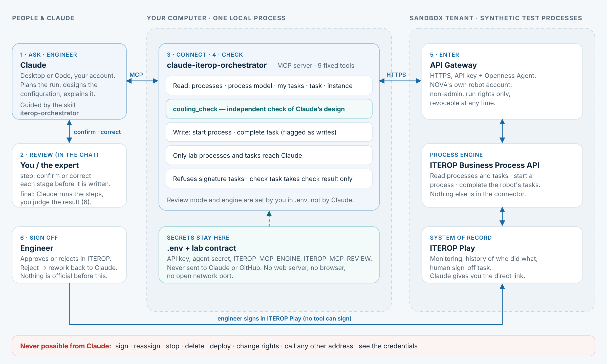

# aif-twinforge

**Agent-assisted AI factory digital twin.** Claude, connected through MCP and guided by skills, engineers AI factory configurations, updates the SysML system model and builds the OpenUSD scene. **3DEXPERIENCE ITEROP** governs every step through the cloud API Gateway, and an engineer signs off before anything becomes official.

This repository puts into practice the loop described in NVIDIA's [Developing an AI Factory Digital Twin with an Agent-Assisted Workflow](https://developer.nvidia.com/blog/developing-an-ai-factory-digital-twin-with-an-agent-assisted-workflow/) (October 2026): requirements → OpenUSD twin → engineering study → reviewed revision. It adds the piece the article leaves to "engineering review": a **governed process** that records each step and keeps the human sign-off.



## How it maps to the reference workflow

| Reference workflow (NVIDIA article)                           | In this repository                                                                                                                                                                                |
| ------------------------------------------------------------- | ------------------------------------------------------------------------------------------------------------------------------------------------------------------------------------------------- |
| Frontier model in an agent harness, with skills and MCP       | Claude Desktop / Code with the [`iterop-orchestrator`](.claude/skills/iterop-orchestrator/SKILL.md) skill and the `claude-iterop-orchestrator` MCP connector (`server/iterop-mcp.ts`)             |
| Requirements linked to system elements in SysML (CATIA Magic) | Guarded CATIA Magic connector with signed model receipts (`server/cameo/`, [SYSTEM-MODEL.md](docs/iterop/SYSTEM-MODEL.md))                                                                        |
| Editable OpenUSD scene of the hall and equipment              | Cooling configuration → OpenUSD, with a baseline compare viewer (`server/twin/`, `scripts/twin/`, [OPENUSD.md](docs/iterop/OPENUSD.md))                                                           |
| Design revision handed off for engineering review             | ITEROP process chain with engineer sign-off and rework that carries the full run context ([REWORK-CONTEXT.md](docs/iterop/REWORK-CONTEXT.md))                                                     |
| Capacity question under a fixed power budget                  | AI-zone scenario: densest-rack check, in-row CDUs ([DEMO-AI-ZONE.md](docs/iterop/DEMO-AI-ZONE.md)) and change against a baseline ([DEMO-CHANGE-SCENARIO.md](docs/iterop/DEMO-CHANGE-SCENARIO.md)) |

## Control

- Claude gets a narrow set of fixed tools, never sees credentials and cannot sign or approve its own work.
- An independent check verifies each configuration Claude proposes (`server/iterop/proposal-check.ts`).
- Reviews run **step by step** or **at the end** (`ITEROP_MCP_REVIEW=step|final`); the sign-off always stays with a person in ITEROP.
- Live mode talks only to a sandbox tenant, admitted by a private contract. Simulated mode makes no network call.

Status: proven live on a sandbox (secure API connection, reading processes, starting a process from a plain-language request); the full chain runs end to end in simulation. Summaries: [executive](docs/iterop/SUMMARY-EXECUTIVE.md) · [technical](docs/iterop/SUMMARY-TECHNICAL.md).

## Run it

Node.js 22.12 or later (24 recommended).

```bash
git clone https://github.com/opedoussaut/aif-twinforge.git
cd aif-twinforge
npm ci
npm run dev
```

Open **http://127.0.0.1:3000** for the orchestration lab. Everything runs on the simulated engine until you add a private configuration.

### Connect Claude

- **Direct (recommended):** `npm run iterop:mcp` — see [CLAUDE-DIRECT.md](docs/iterop/CLAUDE-DIRECT.md).
- **Through the local server:** `npm run mcp` — see [CLAUDE-MCP.md](docs/iterop/CLAUDE-MCP.md).
- **System model:** `npm run cameo:mcp` — see [SYSTEM-MODEL.md](docs/iterop/SYSTEM-MODEL.md).

### Go live on a sandbox

Copy `.env.example` to `.env` and follow [LAB-ORCHESTRATION.md](docs/iterop/LAB-ORCHESTRATION.md): an API Gateway application (`APIKey`), an Openness Agent, and a reviewed contract from `config/lab-contract.template.json` stored under `.private/`. Never commit `.env` or `.private/`.

### Twin

```bash
npm run twin:usd    # cooling configuration → OpenUSD
npm run twin:view   # local viewer with baseline compare
```

## Verify

```bash
npm run check       # typecheck, unit tests, production build
npm run test:e2e    # browser tests (Playwright)
```

## Structure

```
server/iterop/      ITEROP connector, process chain, orchestrator, proposal check, live API Gateway engine
server/iterop-mcp.ts  claude-iterop-orchestrator MCP connector (stdio)
server/cameo/       guarded CATIA Magic connector and signed model receipts
server/twin/        OpenUSD generation for the cooling configuration
src/                orchestration lab (React)
scripts/            OpenAPI resolver, twin tools, demo recording
docs/iterop/        architecture, setup, scenarios and summaries
.claude/skills/     iterop-orchestrator and nova-iterop skills
```

History: extracted on 3 November 2026 from [`3dx-mcp-gateway`](https://github.com/opedoussaut/3dx-mcp-gateway) (branch `claude-iterop-orchestrator`), keeping the commits that touched this scope.
